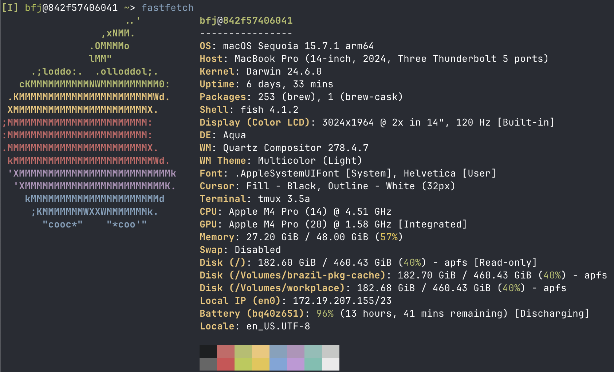

# Saddling a new mac in 2025

Notes on setting up a new mac laptop in 2025.

The new hotness:




## Setup

- [x] trackpad click and right click
- [x] capslock -> ctrl
- [x] keyboard settings: turn off . after double space
- [x] set default browser Chrome, default search engine DuckDuckGo
  - TODO: install kagi extension, set default to kagi
- [x] install [wezterm](https://wezterm.org/) and [ghostty](https://ghostty.org/) (currently using ghostty full-time)
  - config requires fish, ~/.wezterm.lua
  - ghostty is good out of box
- [x] install iTerm2 as a backup terminal
  - terminal bell OFF
- [x] install [homebrew](https://brew.sh)

```
$ echo >> /Users/bfj/.zprofile
$ echo 'eval "$(/opt/homebrew/bin/brew shellenv)"' >> /Users/bfj/.zprofile
$ eval "$(/opt/homebrew/bin/brew shellenv)"
```

Note: I'm only configuring zsh lightly in order to bootstrap fish.

  - [x] install from brew:

```
$ brew install \
  awscli  \
  # automatically re-establish ssh connections that go through a proxy  \
  autossh  \
  # better `cat`/`less`  \
  bat  \
  boost  \
  cmake  \
  # watch file changes and execute a command  \
  entr  \
  # better `ls`  \
  eza  \
  fastfetch  \
  # better `find`  \
  fd  \
  # better `zsh` (don't @ me)  \
  fish  \
  # fuzzy text/filesystem search  \
  fzf  \
  # github CLI  \
  gh  \
  git  \
  # post-modern model text editor  \
  helix  \
  htop  \
  jq  \
  mise  \
  mosh  \
  neovim  \
  ninja  \
  node  \
  nvm  \
  pandoc  \
  # better `grep`  \
  rg  \
  texlive  \
  tmux  \
  # python package and project management  \
  uv  \
  xz  \
  # better `cd`  \
  zoxide
```

- [x] fonts
  - https://www.nerdfonts.com/font-downloads
- [x] rustup: curl to `sh` install https://rustup.rs/ 
- [x] opam: `brew install opam && opam init`
- [x] setup rclone backup to S3
- [x] dotfiles
  - [x] dotfiles includes fish config
- [x] boot neovim setup: https://github.com/benjaminfjones/kickstart.nvim
- [x] download selected backups from old laptop
  - tmp/
  - Desktop/
- [x] Install VSCode as a backup editor

## To describe / TODO

- [ ] clone personal github repos
- [ ] connect to private tailscale network
